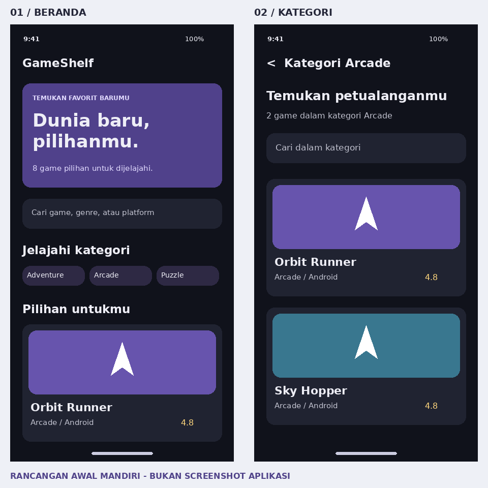
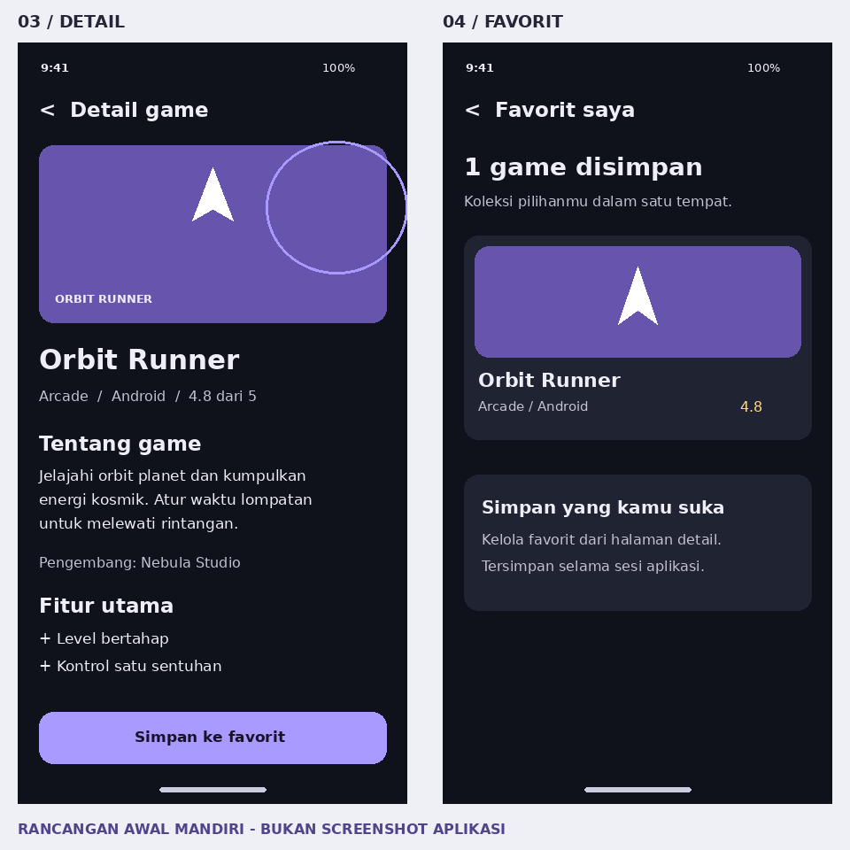

UTS / MOBILE PROGRAMMING

GameShelf

Perancangan Antarmuka Katalog Game
Berbasis Flutter

Nama lengkap: [isi nama lengkap]

NIM: [isi NIM]

Kelas: [isi kelas]

Fakultas / Program studi: [isi]

Universitas: [isi]

Semester Ganjil 2025/2026<br/>Sesuai periode pada soal

Draf laporan proyek. Identitas, logo, screenshot implementasi, dan hasil uji aktual perlu dilengkapi sebelum pengumpulan.


---

# 01 / Pendahuluan

## Latar belakang dan tema

GameShelf adalah prototipe aplikasi mobile untuk menjelajahi katalog game berdasarkan genre. Informasi disajikan melalui kartu visual, pencarian, halaman kategori, dan halaman detail. Tema ini dipilih karena cocok untuk menerapkan widget berulang, struktur data JSON, dan navigasi antarlayar dalam satu alur penggunaan yang mudah dipahami.

Masalah yang ditangani ialah kebutuhan menemukan informasi game secara terstruktur tanpa membuka banyak halaman yang tidak saling terhubung. Pengguna dapat mencari judul, membatasi pencarian berdasarkan genre, lalu menyimpan pilihan ke daftar favorit selama sesi aplikasi.

## Tujuan dan batasan

Tujuan pengembangan adalah menyusun GUI Flutter yang konsisten, menerapkan minimal tiga halaman yang saling terhubung, menampilkan data dummy lokal, serta memisahkan akses data dari tampilan untuk mendukung integrasi API selanjutnya. Versi ini memuat empat halaman dan delapan game fiktif dalam empat genre.

Cakupan proyek adalah katalog informasi. Unduhan game, login, transaksi, backend, dan sinkronisasi akun belum diimplementasikan. Favorit disimpan di memori dan akan hilang ketika aplikasi dimulai ulang. Nama game, pengembang, serta rating merupakan data demonstrasi.

## Pemetaan ketentuan tugas

| Ketentuan | Implementasi yang disiapkan |
| --- | --- |
| Minimal 3 halaman | Beranda, kategori, detail, dan favorit. |
| Data terstruktur | 8 objek JSON, model Game, ID unik, rating 0-5. |
| Navigasi Flutter | Navigator.push dan MaterialPageRoute; tombol kembali. |
| Layout responsif | LayoutBuilder, Wrap, konten maksimal 1160 px. |
| Dokumentasi | README, rancangan UI, kode, test, dan laporan PDF. |
| Luaran daring | Repositori GitHub dan tautan Google Drive perlu dibuat setelah verifikasi lokal. |


---

# 02 / Perancangan antarmuka

Rancangan dibuat mandiri menggunakan tata letak kartu dan tema gelap. Latar #10121B, permukaan #202331, serta aksen ungu #A89AFF membentuk hirarki visual. Tipografi menggunakan font bawaan sistem Flutter. Ikon Material menjadi ilustrasi lokal sehingga tidak bergantung pada koneksi internet.

Gambar 1. Desain awal beranda dan kategori. Ilustrasi komposisi, bukan screenshot hasil menjalankan Flutter.



Beranda menonjolkan pencarian dan kategori. Halaman kategori mempertahankan bahasa visual kartu yang sama, dengan pencarian khusus genre. Padding 20 px, jarak kartu 16 px, dan sudut membulat digunakan untuk menjaga kerapian.


---

# 03 / Detail dan favorit

Halaman detail menyajikan identitas game, genre, platform, rating, deskripsi, pengembang, dan fitur. Tombol favorit menggunakan label yang berubah sesuai status. Halaman favorit menjadi tempat meninjau pilihan yang sudah disimpan.

Gambar 2. Desain awal detail dan favorit. Teks serta komposisi akhir dapat berbeda mengikuti ukuran layar dan isi JSON.



Implementasi memakai ikon Material, sedangkan gambar rancangan memakai bentuk geometris sederhana. Panel bantuan pada rancangan favorit merupakan eksplorasi desain; implementasi akhir menampilkan jumlah, daftar game, dan pesan saat daftar kosong. Perbedaan ini dicatat agar rancangan tidak disalahartikan sebagai bukti hasil aplikasi.


---

# 04 / Implementasi program

## Struktur dan tanggung jawab

| Lokasi | Tanggung jawab |
| --- | --- |
| lib/main.dart | Tema global dan injeksi GameRepository. |
| lib/models/game.dart | Model immutable dan konversi JSON. |
| lib/data/ | Repository data lokal, filter, dan status favorit. |
| lib/pages/ | HomePage, CategoryPage, DetailPage, FavoritesPage. |
| lib/widgets/game_widgets.dart | Kartu, ilustrasi, layout adaptif, dan pesan kosong. |
| assets/data/games.json | Delapan game dummy tanpa ketergantungan jaringan. |
| test/gameshelf_test.dart | 13 kasus uji model, data, navigasi, dan UI. |

## Pengolahan JSON lokal

LocalGameRepository membaca asset satu kali melalui Future yang disimpan di initState. JSON dipetakan ke model Game dan diperiksa agar ID tidak duplikat. FutureBuilder menyediakan tampilan loading, hasil, serta pesan gagal dengan tombol coba lagi.

```dart
final raw = await _bundle.loadString('assets/data/games.json');
final data = jsonDecode(raw) as List<dynamic>;
final games = data.map((item) =>
  Game.fromJson(item as Map<String, dynamic>)).toList();
```

Field data meliputi id, title, genre, platform, developer, rating, description, color, symbol, dan features. Warna disimpan sebagai string ARGB; symbol dipetakan ke ikon lokal. Pencarian mengabaikan kapital dan spasi di awal/akhir, lalu memeriksa judul, genre, dan platform.

## Kesiapan integrasi API

```dart
abstract class GameRepository {
  Future<List<Game>> fetchGames();
}
```

Tahap berikutnya dapat menambahkan ApiGameRepository dengan kontrak yang sama. Adapter perlu mengikuti bentuk respons server, termasuk validasi, timeout, serta penanganan kegagalan. Endpoint API belum diberikan pada soal; versi UTS tetap memakai JSON lokal.


---

# 05 / Navigasi dan layout

## Alur pengguna

Beranda > chip kategori > daftar kategori > kartu game > detail. Dari beranda, ikon hati membuka favorit; kartu favorit juga membuka detail. Tombol kembali mengeluarkan route teratas sehingga pengguna kembali ke layar sebelumnya. Objek Game diteruskan melalui konstruktor agar detail sesuai kartu yang dipilih.

```dart
Navigator.of(context).push(MaterialPageRoute<void>(
  builder: (_) => DetailPage(
    game: game, favorites: favorites),
));
```

## Widget dan perubahan status

Scaffold dan AppBar membentuk kerangka halaman. Column, Row, Expanded, dan Wrap mengatur susunan konten. Card dan InkWell menjadi kartu interaktif; TextField mengubah pencarian melalui setState. Container, gradient, dan Stack membentuk ilustrasi; Chip menampilkan metadata. Favorit memakai satu ChangeNotifier bersama dan ListenableBuilder sehingga perubahan detail dapat tercermin pada daftar favorit.

```dart
void toggle(String id) {
  if (!_ids.add(id)) _ids.remove(id);
  notifyListeners();
}
```

## Responsivitas dan keterbacaan

LayoutBuilder menggunakan lebar area katalog setelah padding untuk menentukan jumlah kolom. Di bawah 600 px digunakan satu kolom, 600-949 px dua kolom, dan mulai 950 px tiga kolom. Tinggi kartu mengikuti isi melalui Wrap, bukan rasio tetap. Konten dibatasi 1160 px dan dibungkus SingleChildScrollView serta SafeArea.

```dart
final columns = box.maxWidth >= 950 ? 3
  : box.maxWidth >= 600 ? 2 : 1;
final width = (box.maxWidth - (columns - 1) * 16) / columns;
```

Tombol memiliki label atau tooltip. Deskripsi dan daftar fitur dapat membungkus ke baris berikutnya. Pengujian perangkat tetap diperlukan, khususnya pada lebar 320 px, orientasi landscape, dan ukuran font sistem 150-200%.


---

# 06 / Hasil dan pembahasan

**Hasil yang tersedia:** source code, asset JSON, rancangan UI, dokumentasi, dan kasus pengujian telah disusun. Pemeriksaan statis data menggunakan Python memastikan delapan ID unik, empat kategori, kelengkapan field, dan rating pada rentang 0-5. Ini bukan pengganti analyzer Dart atau pengujian Flutter.

**Batas verifikasi:** Flutter SDK tidak tersedia di lingkungan penyusunan. Aplikasi, flutter analyze, dan flutter test belum dijalankan. Tidak ada klaim bahwa APK berhasil dibangun atau semua interaksi telah lulus uji. Kolom hasil aktual harus diisi berdasarkan pelaksanaan pada komputer/perangkat mahasiswa.

## Perbandingan rancangan dengan kode

| Aspek | Kesesuaian pada tingkat kode |
| --- | --- |
| Warna dan hirarki | Tema gelap, aksen ungu, hero dan kartu diterapkan. |
| Empat halaman | Beranda, kategori, detail, favorit tersedia. |
| Ilustrasi | Rancangan geometris diterjemahkan menjadi ikon Material. |
| Kartu dan konten | Tinggi mengikuti isi; detail menampilkan JSON lengkap. |
| Favorit | Panel bantuan rancangan disederhanakan menjadi daftar dan empty state. |

## Rencana verifikasi fungsional

| Uji | Hasil yang diharapkan | Status |
| --- | --- | --- |
| Katalog offline | 8 game dan 4 kategori tersedia. | Belum dijalankan |
| Cari ORBIT | Orbit Runner ditemukan. | Belum dijalankan |
| Kategori Arcade | Orbit Runner dan Sky Hopper saja. | Belum dijalankan |
| Detail dan kembali | Data cocok, kembali ke asal route. | Belum dijalankan |
| Tambah/hapus favorit | Daftar mengikuti perubahan status. | Belum dijalankan |
| 320 / 800 / 1200 px | Konten tidak overflow. | Belum dijalankan |
| Analyzer dan test | Tidak ada error; 13 kasus lulus. | Belum dijalankan |


---

# 07 / Bukti implementasi

Bagian ini sengaja belum diisi gambar hasil aplikasi karena program belum dijalankan. Setelah menjalankan Flutter, ganti setiap kotak dengan screenshot asli. Jangan menggunakan gambar rancangan sebagai bukti implementasi.

## A. Beranda

Katalog berhasil dimuat dari JSON; pencarian dan kategori terlihat.

## B. Kategori Arcade

Hanya Orbit Runner dan Sky Hopper ditampilkan.

## C. Detail Orbit Runner

Identitas, deskripsi, fitur, serta tombol favorit ditampilkan.

## D. Favorit

Orbit Runner muncul setelah tombol Simpan ke favorit ditekan.

Tambahkan perangkat/OS, versi Flutter, tanggal pengujian, dan hasil aktual. Screenshot boleh ditempatkan pada halaman terpisah agar tetap terbaca.


---

# 08 / Kesimpulan

GameShelf telah disusun sebagai implementasi sumber aplikasi katalog game dengan empat halaman terhubung, data JSON terstruktur, pencarian, dan favorit dalam sesi. Pemisahan model, repository, halaman, dan widget membantu keterbacaan kode serta membuka jalur integrasi API. Rancangan visual mengutamakan konsistensi warna, hierarki informasi, dan keterbacaan.

Pencapaian saat ini berada pada penyusunan kode dan dokumentasi serta pemeriksaan statis data. Kelayakan runtime dan kesesuaian visual pada perangkat belum dapat disimpulkan sebelum pengujian Flutter dilaksanakan. Pengembangan lanjutan meliputi akses API, penyimpanan favorit permanen, serta optimasi daftar bila jumlah data bertambah.

## Langkah menjalankan dan menyelesaikan luaran

```dart
flutter create --empty --project-name gameshelf \
  --platforms=android,web .
flutter pub get
dart format lib test
flutter analyze
flutter test
flutter run
```

Jalankan perintah dari folder gameshelf. Perintah pertama melengkapi scaffold Android dan web sesuai SDK lokal. Setelah berhasil, isi identitas dan logo, jalankan checklist, tambahkan screenshot, dan ekspor ulang laporan dari naskah editable. Unggah proyek ke GitHub dan PDF akhir ke Google Drive melalui akun mahasiswa.

| Luaran | Tautan yang harus diisi |
| --- | --- |
| Repositori GitHub | [isi tautan repositori setelah upload] |
| Laporan Google Drive | [isi tautan PDF setelah upload] |

## Referensi

1. Soal UTS(1).pdf, Ujian Tengah Semester Mobile Programming, Semester Ganjil 2025/2026.<br/>2. Flutter, Send data to a new screen: https://docs.flutter.dev/cookbook/navigation/passing-data<br/>3. Flutter API, LayoutBuilder: https://api.flutter.dev/flutter/widgets/LayoutBuilder-class.html<br/>4. Flutter, General approach to adaptive apps: https://docs.flutter.dev/ui/adaptive-responsive/general

Desain awal GameShelf dibuat mandiri untuk proyek ini; tidak menyalin contoh tampilan dalam soal. Referensi Flutter digunakan untuk dasar navigasi dan layout.
